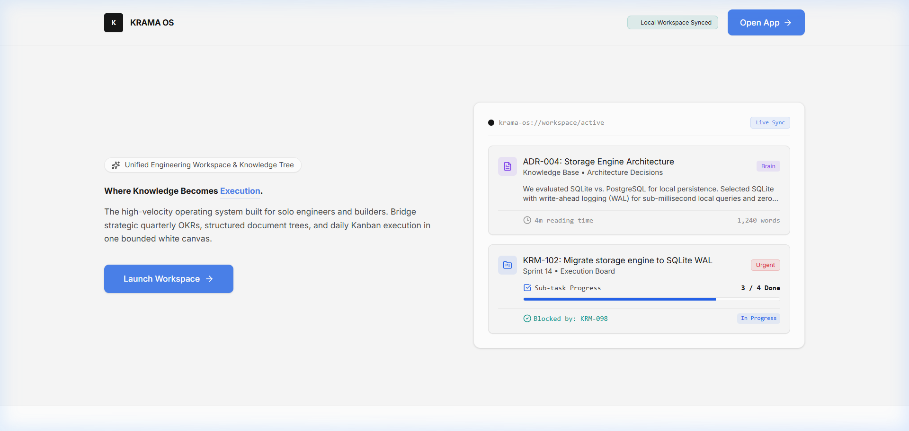
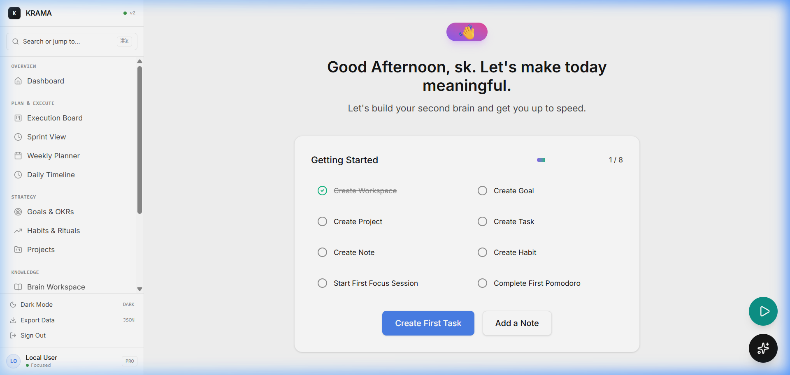
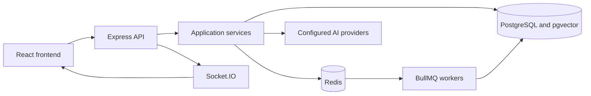

# Krama

Krama is a personal workspace for keeping notes, planning work, and tracking progress. Documents, tasks, projects, goals, habits, and focus sessions share the same workspace, so you can move from an idea to a plan without maintaining separate copies of the same information.

The project is intended for personal use on a local machine. It supports multiple workspaces and membership roles, while Docker provides the database, queue services, API, workers, and frontend needed to run it.

## What you can do

Brain contains nested spaces and documents, a rich text editor, search, entity links, and document history. Projects connect that knowledge to tasks and milestones. The execution board and sprint views help organize the work, while the planner shows daily schedules and weekly capacity.

Goals and habits provide longer-term progress and recurring check-ins. Focus Mode records work sessions, and Dashboard brings the resulting activity together. Progress statistics remain within their own sections. AI features can use configured Groq or Gemini credentials to assist with documents and workspace questions.

Image and wallpaper uploads remain **Coming soon** until R2 storage is configured. A custom domain and public deployment are outside the current personal-workspace setup.





## Run the application

Install Docker Desktop, then create the root environment file. In PowerShell:

```powershell
Copy-Item .env.example .env
```

Set independent PostgreSQL and Redis passwords, generate a random `JWT_SECRET` of at least 48 characters, and keep the connection URLs consistent with those credentials. Set `FRONTEND_URL` to `http://localhost:8080` when using the supplied `WEB_PORT=8080`. Replace optional provider placeholders with valid keys or leave them blank.

Build and start the production Compose stack:

```sh
docker compose -f docker-compose.prod.yml up -d --build
```

Open <http://localhost:8080>. The migration service must finish successfully before the API and workers start. The default port comes from `.env.example`; production Compose uses port 80 if `WEB_PORT` is unset.

For host development, database maintenance, and test commands, read the [development guide](docs/development/README.md).

## How it is built

The React frontend calls the Express API and uses Socket.IO events to refresh affected data. Services enforce workspace access, perform database writes through Prisma, and publish committed changes. PostgreSQL stores application records and vector search data. Redis supports queues, caching, rate limits, and coordination; BullMQ workers handle background jobs.



| Area | Main technologies |
| --- | --- |
| Frontend | React 19, TypeScript, Vite 8, Tailwind CSS 4, TanStack Query, Tiptap, dnd-kit |
| API and workers | Node.js, Express 5, TypeScript, Prisma 7, BullMQ, Socket.IO |
| Storage | PostgreSQL 15 with pgvector, Redis 7 |
| Development | pnpm workspaces, Oxlint, Node test runner, Playwright |

The Docker images use Node 24. Host development supports the Node versions declared in [package.json](package.json), with pnpm pinned to 9.15.0.

## Repository layout

```text
apps/server/          API, workers, services, database schema and migrations
apps/web/             Frontend, feature components and theme styles
packages/types/       Shared TypeScript contracts
packages/validation/  Shared validation schemas
e2e/                  Module, mocked browser and live browser tests
docs/                 Development guides, design guidance and archived reviews
```

## Documentation

Start with the [documentation index](docs/README.md). The [product guide](PRODUCT.md) describes the intended daily workflow, and the [design guide](DESIGN.md) explains the shared interface rules. [CHANGELOG.md](CHANGELOG.md) records product changes.

Earlier reviews and repair notes are kept in the [audit archive](docs/archive/audit/README.md). They describe specific revisions and should be read as historical evidence. Current behavior should be checked against source code and tests.
