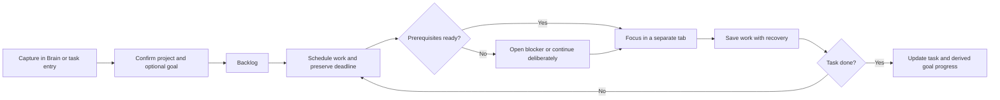

# Krama connected-flow review — October 15, 2026

**Current status: all six findings below have been fixed.** See [implementation and verification](2026-10-15-connected-flow-fixes.md). The findings and failed reproductions below are retained as pre-fix history.

**Original review result: six unresolved P2 issues confirmed: four additional flow gaps and the two previously reported Goal/Focus issues.** One additional gap was an incomplete application of the earlier date-rule fix across Planner views. That review added diagnostic tests, fixtures, and documentation; the later implementation is linked above.

## Confirmed gaps from this pass

### CF-01 — P2: Weekly Planner still hides deadlines when a task is scheduled later

Locations: [planner.service.ts](../../apps/server/src/services/planner.service.ts:290), [PlannerMatrix.tsx](../../apps/web/src/components/planner/PlannerMatrix.tsx:343).

The earlier fix updated the day-view hook, but the server's day expansion and weekly grid still use scheduled-date precedence. The server first fetches a task whose deadline is in range, then drops it from the response's mapped tasks if its scheduled date is outside that range. The weekly grid independently suppresses deadline placement whenever a scheduled date exists.

Reproduction: `Submit proposal` is due October 15 and scheduled October 20. Request October 12–18. The real Planner service receives that task from the database stub but returns zero tasks and a scheduled-task count of zero. In the browser, the same record is visible in day view (which also fetches workspace tasks) and disappears when switching to weekly plan view.

Required correction: apply one schedule/deadline visibility rule to server expansion and every calendar view. Preserve a task's due-date visibility even when scheduled outside the range. If a task is shown on two dates, deduplicate its contribution to weekly task totals and completion percentages by ID. Include a regression that uses the real service response rather than a hand-built week response containing the raw task.

### CF-02 — P2: Board hierarchy filtering makes open subtasks unreachable

Location: [KanbanBoard.tsx](../../apps/web/src/components/KanbanBoard.tsx:253).

The Board removes a child whenever its parent exists anywhere in the combined active/canceled task array, before applying search, project, priority, and archive filters to that parent. It does not check whether the parent will actually remain visible.

Two browser reproductions:

- Parent `Epic planning` and child `Fix keyboard trap` are open. Searching the child's exact title displays no matching task because the parent does not match and the child was already removed.
- The parent is canceled, the child remains open, and the archive is hidden. The canceled parent is still present in the combined array, so neither parent nor child is visible.

Required correction: preserve matching descendants in filtered results. Either display them as independent matches or retain a visible parent with the matching child exposed. A hidden/canceled parent must not hide open child work. Apply the same behavior to project and priority filters.

### CF-03 — P2: Pinning a daily habit changes rest-day behavior in Planner

Locations: [planner.service.ts](../../apps/server/src/services/planner.service.ts:271), [PlannerMatrix.tsx](../../apps/web/src/components/planner/PlannerMatrix.tsx:284), [habit.service.ts](../../apps/server/src/services/habit.service.ts:195), [HabitCards.tsx](../../apps/web/src/components/habits/HabitCards.tsx:415).

Pinned habits receive an actionable occurrence on every date, regardless of scheduled weekdays. The Habits page disables a daily habit on its rest days. Planner enables its checkbox on those same days, while the logging service marks the completion off-schedule and excludes it from streaks.

Reproduction: pin a Monday-only daily habit. On Thursday, October 15, its Habits card is disabled as `Not scheduled today`, while Planner's `Mark Monday ritual complete on Oct 15` control is enabled. Calling the real logging and Planner services records `offSchedule: true`, shows a checked Planner occurrence, and leaves the streak at zero.

Required correction: pinning should affect visibility without silently changing schedule eligibility. Keep rest-day cells disabled, or offer an explicitly labeled extra log that explains its effect on streaks. Pass cadence and schedule information through the Planner routine/occurrence contract so the UI can make this distinction. Weekly habits need a separate target-based presentation.

### CF-04 — P2: Trashing a Brain document tree selects a deleted descendant

Locations: [Editor.tsx](../../apps/web/src/components/brain/Editor.tsx:611), [document.service.ts](../../apps/server/src/services/document.service.ts:213), [BrainWorkspace.tsx](../../apps/web/src/components/BrainWorkspace.tsx:615).

The server recursively trashes a document and its children. The editor chooses the next document from the old list by excluding only the selected parent. If a child is next in that list, it navigates to the child that was also just trashed.

Reproduction: list `Parent note`, its `Child note`, then an independent `Surviving note`. Trash the parent through More actions. After success the URL becomes `?doc=nested`, and the editor shows Document unavailable even though the surviving note remains available.

Required correction: exclude the entire deleted subtree when selecting the next document, or select from the refreshed surviving list. Clear the document parameter if nothing survives. Keep Undo bound to the deleted root so the tree can be restored together.

## Previously reported issues at review time

At the time of this review, the [fix recheck](2026-10-15-fix-recheck.md) cases were rerun and still failed. Both now pass with the later implementation:

| Finding | Observed result |
| --- | --- |
| RC-01 — Goal partial-save draft loss | Save a check-in after editing settings; the unsaved title reverts to the server title. |
| RC-02 — Focus late acknowledgement | Navigate away during completion saving and return after success; the timer restores at 00:00 with Review session disabled. |

Recommended fix order: RC-01 (draft loss), RC-02 (stuck execution), CF-01/CF-02 (hidden work), then CF-03/CF-04 (schedule consistency and navigation).

## Product and flow improvements

These are recommendations, not additional confirmed defects:

1. **Give captured work a next action.** After creating a task from Brain or quick capture, offer Open task, Schedule, and Start Focus with the new task's identity and project context. The task can remain in backlog if the user chooses no action.
2. **Show execution readiness.** Surface unfinished prerequisites before recommending or starting blocked work. Offer to open the blocker or continue deliberately. Define whether blocked tasks can be completed, rather than relying on an implicit policy.
3. **Make closure explicit.** Completing or archiving a goal/project should explain what happens to unfinished tasks and future blocks. Offer keep, reschedule, or move options; keep historical focus logs associated with the original work.
4. **Represent weekly habits as weekly targets.** Show progress such as 2/3 this week and eligible logging days. Separate routine visibility, scheduled obligation, optional extra logs, and future planning from an actual completion.
5. **Use honest scheduling feedback.** The current Move to backlog action clears only `scheduledDate`; a due-today task still belongs in today's deadline list. Label this as removing its scheduled date and retain the deadline visibly, rather than promising that the task moved to backlog.

Suggested connected path:



## Evidence and limits

- Seven targeted browser checks failed on the expected behavior assertions: the two previous cases, one weekly-date case, two Board hierarchy cases, one habit case, and one document-deletion case. These establish six distinct open issues; the Board cases share a root cause.
- Two service probes executed the real Planner/Habit methods with database IO stubbed. They reproduced missing due-in-range work and checked off-schedule occurrences with zero streak contribution. The generated Planner payload was then used by the browser checks.
- The Brain browser test models the recursive delete behavior implemented by `DocumentService.deepDelete`; no real documents were deleted.
- The previous 107-scenario regression run remains historical verification. It was not repeated in this pass because application source was unchanged. Its coverage does not include these new combinations.
- No live database, Redis, provider, or deployed application behavior was verified. No workspace records were modified.

Evidence files:

- [Browser cases](../../.audit/deep-flow.spec.ts)
- [Browser configuration](../../.audit/deep-flow.config.ts)
- [Browser failure log](../../.audit/deep-flow-browser.log)
- [Service probes](../../.audit/deep-flow-services.ts)
- [Generated service payloads](../../.audit/deep-flow-fixtures.json)

```powershell
corepack pnpm --filter server exec tsx ../../.audit/deep-flow-services.ts
corepack pnpm exec playwright test --config .audit/deep-flow.config.ts --reporter=list
```

The service probes assert the reproduced observations; their successful exit confirms reproduction. The browser cases assert the desired behavior and currently fail. Neither result should be described as passing correctness coverage for these six issues.
