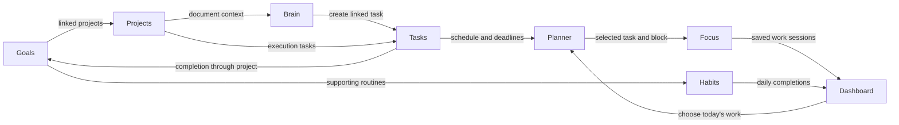

# Krama workflow review — October 15, 2026

Latest status: the [six connected-flow findings have been fixed](2026-10-15-connected-flow-fixes.md), including propagation of the date rule to week/month Planner and Focus entry dates.

**The original nine reproduction scenarios pass.** Later reviews found additional Goal/Focus and calendar/filtering edge cases, which are covered by the latest fixes linked above. This review checks relationships and user journeys across Dashboard, Planner, Goals, Projects, Habits, Brain, and Focus. The original reproductions below are retained as history; their verification scripts now assert the corrected behavior.

The four fixes from the [previous audit](2026-10-15-final-audit.md) remain separate from the additional cases below. In particular, goal IDs are now isolated against wrong-record writes; this review found an additional browser-history draft-loss path.

## Implemented fixes

| Finding | Corrected behavior |
| --- | --- |
| WF-01 | Each Focus completion owns an ID-specific recovery record. Multiple offline tabs retain both payloads; acknowledgements remove only the saved ID. Legacy recovery data remains readable. |
| WF-02 | Ordinary Focus stores tab-local active state scoped to account/workspace. Running and paused timers restore their identity, elapsed work, deadline, and plan after reload. |
| WF-03 | Planner considers scheduled and due dates independently, displays each task once, and labels due-today work and scheduling beyond the deadline. |
| WF-04 | Parents always derive weighted key-result progress. Manual/project-task selection applies to leaves. Removing the last key result restores an automatic leaf's task metric; recomputation shares the workspace lock used by goal edits. |
| WF-05 | Tab-local drafts retain their original account/workspace/goal and version across browser history. Conflicts retain the draft; successful save or confirmed discard clears it. |
| WF-06 | Brain task creation waits for document metadata/body saves. Save errors and revision conflicts block task creation until resolved. |
| WF-07 | Focus uses remaining eligible work slots to decide fallback, so blocks linked to completed tasks cannot hide other due work. |
| WF-08 | Project deadlines preserve calendar dates in timeline labels; remaining days use calendar-day differences. |
| WF-09 | Weekly habit membership uses the canonical completion date key before assigning the Sunday-start week. |

New regression coverage lives in [workflow-regressions.spec.ts](../../e2e/mocked/workflow-regressions.spec.ts), [focus-recovery.spec.ts](../../e2e/unit/focus-recovery.spec.ts), and [workflow_progress.test.ts](../../apps/server/src/__tests__/workflow_progress.test.ts).

## Connected workflow being checked



Habit links express support for a goal; the current automatic goal metric is task completion through projects. The diagram does not imply that habit check-ins currently increase goal percentages.

## Original findings and reproductions

### WF-01 — P1: Two failed Focus saves can overwrite each other's recovery data

Locations: [FocusPage.tsx](../../apps/web/src/components/FocusPage.tsx), lines 176–178, 336–337, and 392.

All unsaved completions for an account/workspace use one localStorage key. Two Focus tabs can run different tasks and fail to save independently. The second completion overwrites the first completion's pending payload. The conditional acknowledgement prevents an older response from deleting a newer payload, but does not prevent this initial overwrite.

**Reproduction:** start a 25-minute task in one tab and a 30-minute task in another; simulate save failures. The pending recovery record first contains `t1`, then contains only `t2`. Reloading `t1` loads `t2` as the pending completion and rewrites `t1`'s saved plan with a null session, removing its remaining session snapshot.

**User impact:** completed work can be lost during offline/network failure, especially now that Focus entry points intentionally open new tabs.

**Required behavior:** persist each completion under its own immutable completion ID, recover all pending records, and acknowledge only the matching record. Any single-active-timer policy should be explicit rather than implemented through shared-key collisions.

### WF-02 — P2: Ordinary Focus sessions are lost on reload

Locations: [FocusPage.tsx](../../apps/web/src/components/FocusPage.tsx), lines 163–171 and 303–337.

The ordinary `/focus` session lives in component state and refs. Active-session persistence/restoration is limited to explicit task/block selections. Failed *completed* saves have recovery, but an ordinary in-progress session does not.

**Reproduction:** start the ordinary 25-minute timer, advance one minute, and reload. An active `24:00` becomes an idle `25:00`; the elapsed minute and active session identity are not restored.

**Required behavior:** use the same account/workspace-scoped session persistence for every Focus entry path, with stable completion IDs and an explicit resume/discard decision.

### WF-03 — P2: Dashboard and Planner disagree about tasks due today

Locations: [dashboard.controller.ts](../../apps/server/src/controllers/dashboard.controller.ts), lines 53–61; [useTodayPlanner.ts](../../apps/web/src/hooks/useTodayPlanner.ts), lines 146–164.

Dashboard considers scheduled date and due date independently. Planner's day categorization chooses `scheduledDate || dueDate`, ignoring a due date whenever a scheduled date exists.

**Reproduction:** give a task a due date of October 15 and a scheduled date of October 16. Dashboard displays it in today's work. Planner's October 15 day view displays no row for it, despite both task APIs returning the record.

**Required behavior:** distinguish “scheduled today,” “due today,” and “overdue”; deduplicate by task ID. A later scheduled date must not hide an earlier deadline. Scheduling beyond a deadline should also be disclosed.

### WF-04 — P2: Parent goals have competing progress calculations

Locations: [goal.service.ts](../../apps/server/src/services/goal.service.ts), lines 302–328 and 340–365; [GoalDetailDrawer.tsx](../../apps/web/src/components/goals/GoalDetailDrawer.tsx), lines 767 and 1045–1047.

A goal can have child key results and also use automatic project-task progress. Child changes overwrite its progress with a weighted child rollup. Task changes or automatic-mode updates overwrite the same value with project-task completion. Neither path establishes which source has priority.

**Reproduction:** a parent has one 50% child and no project tasks. Its child rollup is 50%. Running the real automatic-progress service changes it to 0%. Running the real parent-rollup method changes it back to 50%, without changing the child's progress or any tasks.

**User impact:** progress, snapshots, pace, and Dashboard summaries can change according to the last event rather than a stable metric definition.

**Required behavior:** define one source per goal. A straightforward contract is weighted children for parents, with manual or project-task progress selectable only for leaves. Apply that rule on reads, edits, task events, and child events.

### WF-05 — P2: Browser history silently discards unsaved goal drafts

Locations: [Goals.tsx](../../apps/web/src/components/Goals.tsx), lines 68–78 and 630; [GoalDetailDrawer.tsx](../../apps/web/src/components/goals/GoalDetailDrawer.tsx), lines 43–66.

The confirmation covers drawer close controls and explicit parent/child selection. `beforeunload` covers document unloads. Browser Back/Forward within the SPA follows the URL directly and remounts the keyed drawer, bypassing those confirmations. No durable per-goal draft restores the edits.

**Reproduction:** open a parent, select its child, edit the child title, then use Back and Forward. The original child title returns, with zero save requests and zero confirmations.

**Required behavior:** retain drafts by account/workspace/goal ID or guard in-app route changes, including browser history. Keep the ID isolation that prevents an old draft from being saved to a different goal.

### WF-06 — P2: Brain can create a task under a document's old project

Locations: [Editor.tsx](../../apps/web/src/components/brain/Editor.tsx), lines 211–216; [SelectionToTaskModal.tsx](../../apps/web/src/components/editor/SelectionToTaskModal.tsx), lines 54–60; [document.service.ts](../../apps/server/src/services/document.service.ts), lines 388–403.

Changing a document's project uses the asynchronous document save queue. Creating a task bypasses that queue and does not wait for the project change to finish. The server inherits `document.projectId` from the currently persisted document.

**Reproduction:** delay a document's project-change PATCH from `p1` to `p2`, then create a task through the editor shortcut. The task request runs while the metadata PATCH is pending and inherits `p1`. After the PATCH finishes, the document belongs to `p2` and its new task remains in `p1`.

**User impact:** the task enters the wrong initiative and can contribute to the wrong linked goal's automatic progress.

**Required behavior:** wait for the document save barrier before task creation, as other document actions already do. Revalidate the saved document revision/project context before creating the task.

### WF-07 — P2: A completed block prevents Focus from offering other due tasks

Location: [focusTimer.service.ts](../../apps/server/src/services/focusTimer.service.ts), lines 150–176 and 192–204.

Blocks linked to completed tasks are correctly excluded from usable work slots. However, fallback to ordinary task estimates additionally requires that the original work-block array be empty. A completed task's leftover block makes that condition false even when every usable work slot has disappeared.

**Reproduction:** retain one work block linked to a completed task and another open task due today without a block. The real schedule builder returns `mode: empty`, an empty plan, and 480 remaining minutes.

**Required behavior:** base fallback on eligible remaining work. Either offer the remaining due task using its estimate, or clearly explain that the user must time-block it; a stale completed block should not determine this behavior.

### WF-08 — P2: Project deadlines shift calendar days in western timezones

Locations: [ProjectSupportingViews.tsx](../../apps/web/src/components/projects/ProjectSupportingViews.tsx), line 66; [ProjectDetail.tsx](../../apps/web/src/components/ProjectDetail.tsx), lines 245–246.

Project deadlines are passed through `new Date(...).toLocaleDateString()` as instants, while other sections preserve their calendar-date identity. The remaining-days calculation also uses elapsed milliseconds instead of calendar-day differences.

**Reproduction:** store a project target of `2026-10-15T00:00:00Z` and view its timeline in America/Los_Angeles. It displays “Target deadline: Oct 14, 2026.”

**Required behavior:** preserve the stored date key when displaying deadlines and calculate remaining/overdue days with calendar-day helpers. Use the same rule in Goals, Projects, and Planner.

### WF-09 — P2: Weekly habit counts can move completions into the wrong week

Location: [habitFilters.ts](../../apps/web/src/lib/habitFilters.ts), lines 39–48; consumed by [HabitCards.tsx](../../apps/web/src/components/habits/HabitCards.tsx), line 401.

Weekly counts convert canonical UTC-noon completion dates to local instants before assigning the week. In UTC+14, a Saturday's canonical noon becomes Sunday locally. Other habit helpers correctly recover the canonical calendar key by slicing the stored date.

**Reproduction:** on Sunday, October 18 in Pacific/Kiritimati, a completion keyed to Saturday, October 17 is counted in the new Sunday-start week. The real production helper returns 1 where that fixture has zero completions in the current week.

**Required behavior:** recover the canonical completion date key first and calculate week membership from that key. Keep raw completion timestamps separate from the day a habit was logged for.

## Product decisions to make explicit

These are workflow improvements, not additional confirmed defects:

- **Choosing today's work:** when nothing is scheduled, Dashboard should offer an existing backlog task as clearly as creating a new task. Make the path “choose existing work → schedule or start Focus” visible.
- **Blocked work:** decide whether Dashboard/Focus recommendations should skip tasks whose prerequisite is unfinished, or show the blocker and offer to work on it first.
- **Closing work:** define what marking a project/goal completed, paused, or archived means for unfinished tasks and future blocks. Offer an explicit keep/reschedule/move decision rather than leaving the lifecycle relationship implicit.

## Verification and limits

Final verification on the corrected working tree:

| Check | Result |
| --- | --- |
| Production workspace build | Passed |
| Workspace lint | Passed |
| Frontend and test/configuration TypeScript checks | Passed |
| Backend unit/service suites | 21 suites passed, including eight workflow service regressions |
| Shared validation tests | 25 passed |
| Module/mocked-browser regressions | All 107 scenarios passed across the full run and targeted follow-up runs |
| Original service reproductions | Both now return the corrected result |

The full browser run initially passed 105 of 106 scenarios. Its remaining existing test stalled when a dismissible error toast overlapped the retry button; the test now dismisses the toast before retrying and passes. Final follow-up runs passed all 25 affected/recovery scenarios, with the newly added parent-goal control case rerun successfully after its child fixture was given a distinct title. The final suite contains 107 distinct scenarios.

Seven isolated browser cases originally reproduced WF-01, WF-02, WF-03, WF-05, WF-06, WF-08, and WF-09. Two service-level probes reproduced WF-04 and WF-07 using real production methods with mocked database responses. These cases now assert the corrected results, with additional coverage for paused recovery, queue isolation/corruption, goal version conflicts and discard, document save failure/conflict, weighted parent progress, leaf progress, and eligible-block priority.

The cases were verified across targeted runs. The multi-tab fixture was corrected to stagger timer durations because Playwright's clock advances across pages in the same browser context; the corrected case reproduced the overwrite and subsequent snapshot loss.

Evidence scripts:

- [.audit/flow-review.spec.ts](../../.audit/flow-review.spec.ts)
- [.audit/flow-review.config.ts](../../.audit/flow-review.config.ts)
- [.audit/flow-service-probes.ts](../../.audit/flow-service-probes.ts)

```powershell
corepack pnpm exec playwright test --config .audit/flow-review.config.ts
corepack pnpm --filter server exec tsx ../../.audit/flow-service-probes.ts
```

Browser requests are mocked. Service tests replace database/cache IO while executing the shipped service and transaction logic; no application records were modified. Database-backed integration requires isolated `TEST_DATABASE_URL` and `TEST_REDIS_URL`, which are not configured here. Actual provider calls and deployed production behavior were not verified. This is a targeted workflow review, not a claim that every possible application flow has been exhausted.

Ordinary Focus and goal drafts use sessionStorage, which supports reload/history recovery within the tab. They are not a cloud backup or a promise of recovery after browser storage is cleared. Running Focus timers resume from their stored deadline; existing pause/reset controls remain available.
