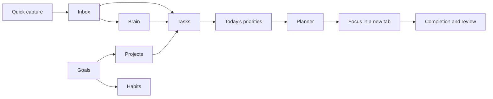

# Krama workspace design

Krama is a personal workspace for capturing thoughts, choosing today's work, making time for it, and connecting that work to longer goals. The interface should make those decisions feel straightforward and dependable.

## Direction

Use a quiet navigation rail and a clear working canvas. Keep Krama's existing Iris accent, neutral surfaces and semantic category colours. Inter remains the interface typeface. Tabular numerals support dates, duration and progress; ordinary navigation, filters and explanations use proportional text.

The core swatches, measured from the implemented theme, are Paper `#FFFFFF`, Slate ink `#11161F`, Iris `#366BD3`, Obsidian surface `#151A22`, Platinum `#E7EAEE`, and light Iris `#6290E7`. Semantic foregrounds use darker tones of their existing hues in light mode so small status labels remain readable.

The distinguishing element is the relationship between intent and time: Dashboard presents today's priorities, Planner shows their place in the week, and Focus opens the chosen work in its own tab. These are actual product functions, so they carry the visual emphasis. Other screens use the same controls and hierarchy while supporting their own jobs.

### Design decisions

| Role | Rule |
| --- | --- |
| Palette | Preserve the live theme variables in `apps/web/src/styles/theme.css`; Iris for selection and primary actions, semantic colours for status |
| Page title | 28px / 36px, weight 650; 24px / 32px on small screens |
| Section title | 16px / 24px, weight 600 |
| Body and controls | 14px / 22px; supporting text 13px / 20px |
| Page spacing | 32px desktop, 24px tablet, 16px phone; aligned headers, toolbars and content |
| Working width | 1280px for overview pages; boards, Planner and Brain use available space |
| Reading width | Approximately 720px for document prose |
| Navigation | 248px desktop rail; labelled mobile drawer; existing collapsed mode retained |
| Surfaces | Plain page headings, bordered working panels, stronger elevation reserved for overlays |
| Shape | 8–10px controls, 14px panels, 18px dialogs; pills only for compact status |
| Interaction | At least 44px touch controls, visible keyboard focus, accurate pending and saved feedback |
| Motion | Brief response to user actions; static cards stay still; reduced motion retains state feedback |

The first concept used a header card and summary cards on every page. That repeated structure gave navigation and secondary information the same weight as the work. The chosen design removes the header card, keeps summaries compact, and lets each screen's working surface define its layout. Decorative glows, marketing copy and constant status pulses are removed from the workspace.

The [UI simplification audit](../audits/2026-10-18-ui-declutter.md) records the subsequent removal of duplicate summaries and controls, the collapsed Brain properties, and the shared mobile assistant placement.

## Screen composition

```text
Navigation rail       Page heading                         Primary action
                      Short explanation of the page's job
                      Search / filters / view controls
                      Main working surface       Supporting context
```

| Screen | Primary job | Composition |
| --- | --- | --- |
| Dashboard | Choose and begin today's work | Greeting and date; priorities and next focus task; quieter progress and capture context |
| Inbox | Decide where a captured item belongs | Preserve the reference-led illustration and clear list; align its controls with the shared system |
| Tasks | See and advance work | Shared heading; one filter bar; board/list/calendar working surface |
| Planner | Give work a place in time | Stable title and view controls; date navigation; compact capacity strip; readable week/day/month surface |
| Goals | Understand direction and progress | Clear goal heading; compact summaries; filters; goals grouped by existing life pillars |
| Projects | Organise the work behind an outcome | Search and status filters; scannable project cards; details keep existing tasks, notes and milestones |
| Habits | Complete routines and see consistency | Time-of-day filters; today's habits; quieter supporting progress; useful first-habit state |
| Brain | Find and develop knowledge | Shared heading; document library; calm reading/editing column; contextual linked information |
| Focus | Work on the chosen task | Preserve separate-tab timer and saved preferences; emphasise task and timer, keep settings secondary |

## Existing product flow



Existing routes, data and recovery behaviour remain authoritative. This design does not introduce extra modules or replace working save, conflict, undo, workspace switching or Focus recovery logic.

## Responsive and accessibility acceptance

- Inspect 320, 390, 768 and 1440px widths in both themes with populated and empty data.
- Keep page-level horizontal overflow absent; deliberate board/calendar scrolling stays inside its working surface.
- Keep dialogs, their actions and their keyboard focus within the viewport.
- Verify navigation, search, forms, editing, selection and focus return with the keyboard.
- Exercise existing error/retry and unsaved-state workflows after styling changes.
- Inspect screenshots and actual element geometry, then run TypeScript, lint, production build and the relevant browser regression suite.
- Record measured results and remaining limits in the implementation audit; a numerical aesthetic score is not an acceptance test.
